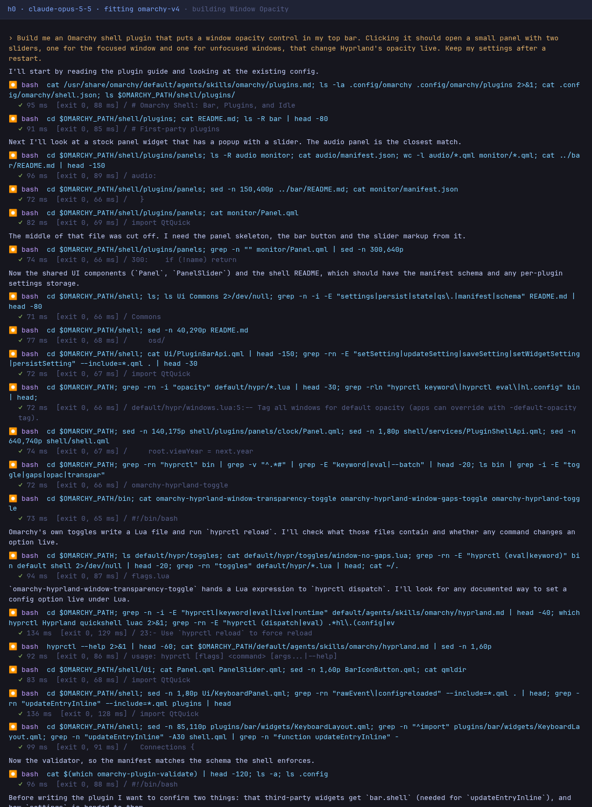

# Window Opacity

An Omarchy shell plugin written by h0, a coding-agent harness, from one request: 25 model turns, $0.83 of Claude Opus 5.5, 3 minutes. Every prompt is in [BUILD.md](BUILD.md), and every step h0 took is in [SESSION.md](SESSION.md).


*Drawn by Quickshell offscreen from this repository's code, beside Omarchy's stock clock, in the Tokyo Night theme. Not a screenshot of a desktop.*

## Install

```bash
omarchy plugin add https://github.com/parker-brown-family/omarchy-h0-opacity.git --enable
```

## What it was asked

> Build me an Omarchy shell plugin that puts a window opacity control in my top bar. Clicking it should open a small panel with two sliders, one for the focused window and one for unfocused windows, that change Hyprland's opacity live. Keep my settings after a restart.

## How it was made

| prompt | what was sent | turns | prompt tokens | output tokens | cost | minutes | checks after it |
|---|---|---|---|---|---|---|---|
| 1 | the idea | 25 | 1,046,251 | 14,790 | $0.83 | 2.9 | all pass |
| **all** | | **25** | | | **$0.83** | **2.9** | |



*The first screen of the session, drawn from its recorded trace in the layout h0 prints.*

## Credit

The idea comes from brownfamilysports.opacity, a cut of wicky14's Rounded Corner Blur. h0 never saw that code: it worked in a sandbox with the network off and the original out of reach.

## How this was checked

After each reply: Omarchy's own `omarchy-plugin-validate`; every entry point loaded in Quickshell offscreen with no QML errors from the plugin's files; the plugin switched on in `shell.json`; and a check for what it was asked to do. Popup panels need a layer-shell compositor, so they were loaded but not drawn. It has not been run on a live desktop by anyone yet; issues are welcome.

Part of [omarchy-h0-builds](https://github.com/parker-brown-family/omarchy-h0-builds), which has the same request built without the Omarchy fitting, and the builds that failed.

MIT licence.
